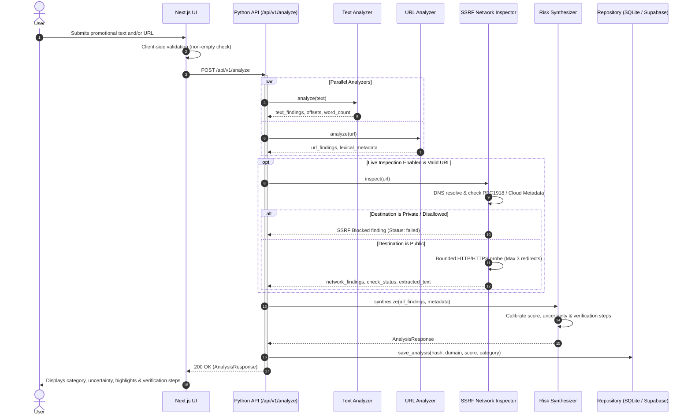

# System Architecture & Technical Specifications

**Project Name:** Risk Classification of Online Investment Schemes Using Text and URL Analysis  
**System Role:** Educational and early-warning screening tool for evaluating user-submitted investment promotions and website links.

---

## 1. Architectural Principles & Boundaries

The platform strictly enforces the following architectural boundaries:

```
[Browser Client] 
       │  (HTTPS / REST)
       ▼
[Next.js + TypeScript Application]
       │  (Internal API Proxy / Rewrites)
       ▼
[Python FastAPI Backend Service]
  ├── Text Analyzer (Linguistic Patterns & Offsets)
  ├── URL Analyzer (Lexical & Impersonation Engine)
  ├── Network Inspector (SSRF-Protected Prober)
  └── Synthesis Engine (Scoring & Uncertainty Calibration)
       │  (Optional Persistence / Fallback)
       ▼
[Supabase PostgreSQL / Local SQLite]
```

### Responsibility Split
1. **Next.js + TypeScript (Frontend)**:
   - Owns user experience, client-side validation, responsiveness, and accessible presentation.
   - Renders findings, evidence highlights, uncertainty gauges, and due-diligence checklists.
   - **Never** owns authoritative risk rules or scoring logic.
   - **Never** exposes database service-role keys or privileged secrets.

2. **Python FastAPI Service (Authoritative Backend)**:
   - Owns authoritative indicator extraction, brand similarity detection, and SSRF-safe network probing.
   - Calibrates heuristic risk scores and assigns categorical verdicts:
     - `lower_concern`
     - `needs_review`
     - `elevated_concern`
     - `insufficient_information`
   - Explicitly accounts for uncertainty (High / Medium / Low).
   - Generates contextual verification steps tailored to detected indicators.

3. **Supabase / PostgreSQL & SQLite Storage**:
   - Stores non-sensitive analysis summaries (SHA-256 hash of text, truncated domain, category, risk score).
   - Stores user feedback for calibration.
   - Graceful fallback: If Supabase credentials are not provided, an embedded SQLite database (`local_store.db`) handles persistence seamlessly.

---

## 2. Component Data Flow



---

## 3. Data Contracts & Models

### Request Schema (`POST /api/v1/analyze`)
```json
{
  "text": "String up to 20,000 characters (optional)",
  "url": "String up to 2,048 characters (optional)",
  "enable_network_check": true
}
```
*Constraint: At least one of `text` or `url` must be provided.*

### Response Schema
```json
{
  "analysis_id": "c1f77d33-...",
  "timestamp": "2026-10-05T19:00:00Z",
  "category": "elevated_concern",
  "category_display": "Elevated Concern",
  "risk_score": 0.725,
  "uncertainty_level": "low",
  "uncertainty_explanation": "Both comprehensive promotional text and a reachable URL were evaluated...",
  "summary": "Elevated concern identified. The submission triggered 3 significant warning indicators...",
  "disclaimer": "This automated screening report is strictly an educational tool...",
  "inputs_analyzed": {
    "has_text": true,
    "text_length": 412,
    "text_word_count": 58,
    "has_url": true,
    "normalized_url": "https://binance-login-verify.top",
    "domain": "binance-login-verify.top"
  },
  "text_findings": [
    {
      "id": "text_guaranteed_profit",
      "title": "Guaranteed Returns or Profit Promise",
      "category": "financial_promise",
      "severity": "critical",
      "explanation": "Promises of guaranteed profits are one of the strongest hallmarks of fraudulent schemes...",
      "evidence": "guaranteed 3% daily profits",
      "start_offset": 45,
      "end_offset": 72,
      "source": "text_analysis"
    }
  ],
  "url_findings": [
    {
      "id": "url_brand_impersonation",
      "title": "Potential Brand Impersonation: 'Binance'",
      "category": "domain_reputation",
      "severity": "critical",
      "explanation": "The domain contains the brand name 'binance', but does not appear to be an official domain...",
      "evidence": "Host 'binance-login-verify.top' references brand 'binance'",
      "source": "url_analysis"
    }
  ],
  "checks_performed": [
    { "name": "text_indicator_scan", "status": "completed", "details": "Analyzed 58 words..." },
    { "name": "url_lexical_analysis", "status": "completed", "details": "Analyzed host, TLD..." }
  ],
  "checks_unavailable": [
    { "name": "official_regulatory_api_lookup", "status": "unavailable", "details": "Requires regional API access..." }
  ],
  "verification_checklist": [
    {
      "step": 1,
      "title": "Verify on Official Regulatory Registry",
      "description": "Check whether the company and its representatives are authorized...",
      "action_url": "https://brokercheck.finra.org/",
      "official_registry": "Securities Regulator Register"
    }
  ]
}
```
